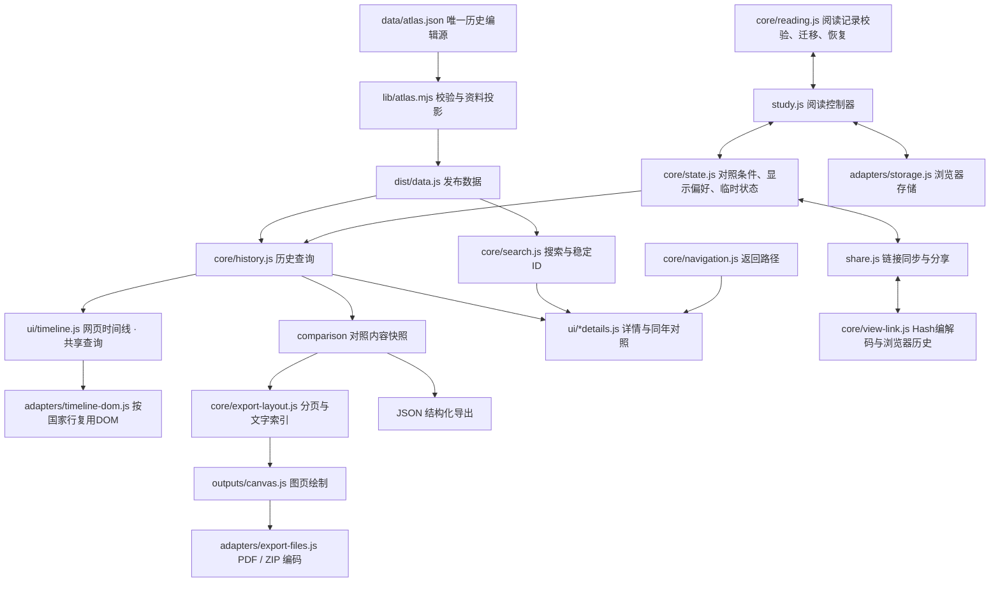

# 解耦后的架构与维护边界

## 数据流



`src/app.js` 负责服务创建和页面共享适配，`src/ui/` 负责页面呈现与交互。这些页面模块通过同一个 `appState` 交换状态；历史查询、搜索、阅读校验与输出编码均可在没有 DOM 的环境中单独使用。

## 源码与成果

- `data/atlas.json`：历史正文、关系、来源与纪年，仍是唯一资料编辑入口。
- `lib/atlas.mjs`：资料校验与投影，保持纯函数。
- `src/core/`：查询、搜索、状态、导航、阅读校验、输出分页。
- `src/ui/`：网页时间线、搜索详情、导航详情、页面控件。
- `src/outputs/`：独立图页绘制，只依赖画布与排版计划。
- `src/adapters/`：存储和文件编码。
- `src/study.js`：通过显式 bridge 连接阅读控制器与页面。
- `src/export.js`：导出对话框与下载流程，将当前条件传给内容模型。
- `src/index.html`、`src/style.css`：页面模板与样式。
- `dist/`：完整生成物。不要直接修改；可删除后重建、独立复制部署或直接打开 HTML。

采用零第三方依赖的确定性拼接构建，保留传统脚本以兼容 `file://`。模块工厂通过 `Zhou` 命名空间提供接口，核心模块不读取页面全局状态；无需引入前端框架或本地服务器。

## 查询与纪年口径

`Zhou.createHistory(data)` 返回历史查询服务：

| 接口 | 含义 |
|---|---|
| `state(id)` / `event(id)` / `person(id)` | 按稳定ID查找 |
| `rulersAt(stateOrId, year)` | 实际即位与条带起点取较早者，考虑国家范围和中断 |
| `compareYear(year, stateIds)` | 返回国家、当年君主、事件和中断说明 |
| `rulersInRange(stateOrId, from, to)` | 采用年表条带与指定范围的交集 |
| `eventsInRange(options)` | 按时间范围、国家和事件类别查询 |
| `comparison(options)` | 生成可序列化、与原始资料分离的对照快照 |

`options` 包含 `from`、`to`、`states`、`category`、`cursor`。年份仍用公元前正整数，`from >= to`。

条带采用年表范围；同年查询纳入已核实实际即位年。两种口径有意分开：晋悼公前573年实际即位，但条带从前572年开始。页面对照、事件联动与浏览器工具共用同年查询。网页和导出共用区间查询口径；网页按需读取并缓存显示内容，导出使用独立快照。显示密度、分页、文字测量分别由呈现模块处理。

快照包含 `schemaVersion`、资料 `version/updated`、查询条件、纪年口径、国家顺序、区间内君主和事件、国家名称字典与来源。事件涉及的其他国家关系不会因为导出只选一个国家而丢失。修改输出快照不会修改资料或其他输出。

## 状态与旧记录

`appState` 分为 `conditions`（国家、结束年、类别、参考年）、`layout`（缩放、行高、顺序、固定等）、`search`、`session`。导航路径由独立 `navigation` 实例维护，浏览器适配保留临时详情 HTML/焦点以精确返回，但不将其写入存储。

阅读控制器只通过 bridge 读取或更新页面；存储适配只负责 JSON 读写。校验和旧记录迁移由阅读模型处理。已有 `zhou-layout-v2`、`zhou-pins-v3`、`zhou-comparisons-v3`、`zhou-reading-v4`、`zhou-visits-v4` 键继续使用。

新人物路由使用 `person:person-xxx`。旧 `person:姓名` 在名称或别称唯一时迁移到稳定ID；同名不猜测匹配。改名时若还需迁移从未打开过的旧姓名记录，应将旧名保留为别称。损坏 JSON、非法字段或不可用存储不应阻止页面启动。

## 渲染与分享

时间线使用独立的时间轴、国家行和参考线节点。`adapters/timeline-dom.js` 按稳定国家ID协调节点：内容不变时保留，顺序变化时移动，内容变化时仅替换对应行。行内容缓存不包含参考年或搜索结果分页，因此这两类变化不会重新生成历史条带；同年对照仍独立更新。缩放会改变坐标，允许替换相关行。

`core/view-link.js` 负责版本化Hash编解码、字段校验及浏览器历史同步，`share.js` 负责页面适配和复制链接。其脚本在 `study.js` 之后加载，确保恢复顺序为默认值、本地阅读记录、链接显式条件。

链接包含 `v=1`、`year`、`end`、`states`、`pinned`、`order`、`zoom`、`from/to/width`、`category`、`mode`、`density`、搜索字段以及可选的稳定详情ID。不同宽度的屏幕根据分享的可见范围调整缩放。临时详情HTML、浏览记录和来源正文不会写入URL。

连续操作在200毫秒防抖后通过 `replaceState` 更新当前历史项。手动Hash导航及前进后退会恢复相应条件，恢复过程中抑制反向写回。没有Hash时不改变本地恢复的滚动位置。文件模式仍支持Hash，但文件路径只能用于能够访问该文件的设备；跨设备分享应使用线上地址。

CI和Pages的触发、权限及初次启用步骤见 [部署说明](DEPLOYMENT.md)。2026年10月18日用户确认，Pages 的发布来源已设置为 GitHub Actions；实际部署结果以仓库最新工作流记录为准。

## 构建与检查

```sh
node build.mjs
node build.mjs --check
node --test tests/*.test.mjs tests/*.test.cjs
```

`sync-data.mjs` 和两个旧 enrich 脚本是统一构建的兼容入口。`--check` 同时校验资料及所有发布文件是否与源码一致，不写入文件。

受限 Windows 环境若在父目录 realpath 阶段出现 EPERM，可在上述 Node 命令中添加 `--preserve-symlinks --preserve-symlinks-main`。这是本次检查实际使用的方式。

测试包括原有内容/交互回归，以及无DOM的核心模块、同名人物、旧记录迁移、损坏存储、输出隔离、PDF/ZIP结构、JSON导出和浏览器工具一致性。DOM桩测试不能代替真实排版、鼠标触摸操作和打印验收。

## 本次范围

保留历史资料正文与原有静态功能，增加结构化对照导出。PDF仍为图片页面；可选择文字的PDF、跨设备同步和史实校勘不在本次重构范围内。

本次真实浏览器验收未完成：浏览器工具禁止直接访问本地 `file://` 文件。需在浏览器手工打开 `dist/index.html` 检查详情返回、刷新恢复、国家固定、窄屏操作及PDF/PNG输出。
