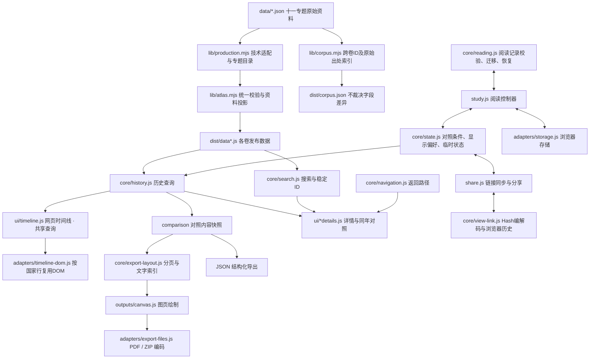

# 解耦后的架构与维护边界

## 数据流

`src/app.js` 创建服务和共享状态，`src/startup.js` 在页面模块加载完成后连接视图适配、渲染回调和初始视图。`src/ui/` 负责页面呈现与交互；阅读与分享注册各自的保存回调，时间线通过明确的页面回调通知变化。历史查询、搜索、组合校验、视图字段、阅读校验与输出编码均可在没有 DOM 的环境中单独使用。

## 源码与成果

- [周朝资料](<../data/atlas.json>)：周朝正文、关系、来源与纪年；其他十个专题从各自原件构建，不写入周朝库。
- [生产专题目录](<../lib/production.mjs>)：统一登记十一个专题、标题、入口及数据资源；共用单一HTML模板，构建自动生成导航。
- [四卷技术适配](<../lib/production-annotations.mjs>)：归一化不支持的类别，保留原值、全部注释及明朝重复逻辑边的原始出处，不修改源文件或放宽校验。
- [跨卷出处索引](<../lib/corpus.mjs>)：按实体类型和稳定ID连接各卷原始JSON位置、源文件及记录散列，字段不同只列差异；不按姓名合并、不给任何卷覆盖优先级。[发布索引](<../dist/corpus.json>)与数据脚本一起纳入发布清单。
- `lib/atlas.mjs`：schema 1/2资料校验与投影，保持纯函数；时期／政权／人物／任期独立集合，输出旧 `states/rulers` 兼容接口。
- `lib/time.mjs`：构建期明确纪元日期与运行时坐标转换；`src/core/time.js`：浏览器时间计算与持久化边界。
- `data/examples/`：独立结构样例，不自动合入周朝发布资料。
- `src/core/`：查询、搜索、状态、导航、阅读校验、输出分页。
- `src/ui/`：网页时间线、搜索详情、导航详情、页面控件。
- `src/ui/view.js`：通过注入的状态、控件与浏览器接口采集和恢复完整视图；导航、阅读与分享共用该入口。
- `src/startup.js`：创建视图适配，连接附属面板和页面生命周期，初始化页面及可选浏览器工具。
- `src/outputs/`：独立图页绘制，只依赖画布与排版计划。
- `src/adapters/`：时间线DOM协调、浏览器存储和文件编码。
- `src/study.js`：通过显式 bridge 连接阅读控制器与页面。
- `src/export.js`：导出对话框与下载流程，将当前条件传给内容模型。
- `src/index.html`、`src/style.css`：页面模板与样式。
- `dist/`：完整生成物。不要直接修改；可删除后重建、独立复制部署或直接打开 HTML。

采用零第三方**运行时**依赖的确定性拼接构建，保留传统脚本以兼容 `file://`。模块工厂通过 `Zhou` 命名空间提供接口，核心模块不读取页面全局状态；无需引入前端框架或本地服务器。Playwright仅为开发验收依赖，不参与构建、不打入发布文件。

## P0 界面与触控边界

- [模板](<../src/index.html>) 的一级工具栏分为搜索、时间（年份与缩放）、政权与视图入口、导出／分享四个模块；专题切换条独立于工具栏。原有控件和ID保留，视图设置面板默认折叠，功能未删除。
- [界面体验](<../src/ui/experience.js>) 管理三步非模态引导、键盘操作、专题标签居中与前后入口。独立全站偏好键 `zhou-ui-v1` 只写 `{advanced,onboardingVersion}`，不进入分享、研究组合或阅读视图；旧键及各专题隔离规则不变。存储拒绝时本次操作仍可用，并提示无法保存。
- [手势模块](<../src/ui/gestures.js>) 由视口、画布、缩放／参考线回调注入，接管鼠标背景拖动、触屏惯性与双指中心缩放；rAF合帧，取消、失焦、新指针会终止旧惯性。缩放仍限0.8—24px／年，不修改历史日期。
- 普通控件最低44×44px；[界面样式](<../src/ui/experience.css>) 保留细线和小年份徽标，金色参考线手柄有独立44px透明热区。密集君主／事件／分段／侧栏按钮不扩大视觉条带：手势模块收集虚拟44px候选，重叠时提供可键盘选择／Esc取消的列表，最终调用原按钮，避免邻项互相覆盖。
- [详情抽屉](<../src/ui/detail-sheet.js>) 仍使用原生模态dialog，768px以下三档35／60／90dvh；独立手柄拖动或键盘／按钮换档、下拉关闭。保留原dialog滚动容器、详情导航、焦点和阅读记录；关闭回调经过既有 `closeDetail`，Esc仍逐级返回。桌面不替换详情布局。
- [构建入口](<../build.mjs>) 显式排序加载新工厂，并拼接基础样式及构建入口显式列出的局部样式清单；所有十一页共用同一模板和应用。不改资料、显示分组／短标签、历史查询、导出或Hash字段契约。

真实离线响应式检查由 [Playwright脚本](<../tests/browser-p0.mjs>) 覆盖十一专题×375／390／768／1200／1440px，额外检查真实双指、惯性、参考线、多候选、底部抽屉、键盘引导、刷新及拒绝存储。实际验收记录与限制见 [P0交付说明](<P0-INTERFACE.md>)。

## P1 语义与可访问性边界

- [展示模型](<../src/core/presentation.js>) 增加类别图标、原标题前缀和原关系的可见行连线；[时间线](<../src/ui/timeline.js>) 消费测宽布局，不改变历史 ID、日期、18px事件／22px车道或接续分组身份。未定年胶囊不生成伪任期。
- [纯横截面模型](<../src/core/time-slice.js>) 重用历史服务，独立于当前可见勾选和视觉组，列全专题存续政权；年次只据显式元年，人物只据明确当年活动。[看板](<../src/ui/time-slice.js>) 是非模态region，使用原稳定详情键，不新增持久化／Hash字段。
- [纪年详情](<../src/ui/navigation-details.js>) 将采用区间和原异说分卡对照，保留来源、原文及未定年原序。仍使用原dialog及scrollTop阅读恢复，不解析文字猜测新年份。
- [可访问性工厂](<../src/ui/accessibility.js>) 负责已渲染前景对比、焦点边界和合并播报；减少动态效果时禁用惯性。普通可交互按钮、图元虚拟命中和原生模态语义仍按P0契约运行。axe/Lighthouse只为开发工具，构建与发布页面无运行时依赖。

验收范围、命令与自动审计限制见 [P1说明](<P1-SEMANTICS.md>)。该阶段的展示渲染不改史料或此前两份显示契约；构建与发布只由人工执行。

## 阶段三：构建期呈现与分享边界

- [构建期呈现](<../lib/site-presentation.mjs>) 只消费编译投影，生成十一套独立SEO元信息、无脚本完整年表与SVG社交图，不重写史料。[可选PNG工具](<../tools/render-social-previews.mjs>) 只暂存图片；[构建入口](<../build.mjs>) 检查SVG／PNG散列及尺寸后统一发布元信息、图片与清单。普通构建仍零依赖。
- [分享摘要](<../src/core/share-summary.js>) 是人读文本，不替代或扩充原Hash协议；[纠错纯函数](<../src/core/correction.js>) 使用固定仓库和专题白名单，原始实体ID不加显示分组前缀，不提交请求。
- [导出控制器](<../src/export.js>) 在原对照快照之外添加透明的exportContext，不裁剪完整命中记录，不把对照快照宣称为可重新导入的Atlas资料。图片PDF编码与旧详情导航保持不变。

流程、PNG开关、反馈表单及本地验收见 [阶段三说明](<STAGE3-PUBLICATION.md>)。构建期生成不引入运行时依赖或主题桥接；发布只由人工执行。

## 查询与纪年口径

`Zhou.createHistory(data)` 返回历史查询服务：

| 接口 | 含义 |
|---|---|
| `state(id)` / `event(id)` / `person(id)` | 按稳定ID查找，保留旧入口 |
| `polity(id)` / `tenure(id)` / `period(id)` | 按独立实体ID查找 |
| `tenuresForPerson(personId)` / `periodsInRange(from,to)` | 同一人物任期／相交专题查询 |
| `rulersAt(stateOrId, year)` | 实际即位与条带起点取较早者，考虑国家范围和中断 |
| `compareYear(year, stateIds)` | 返回国家、当年君主、事件和中断说明 |
| `rulersInRange(stateOrId, from, to)` | 采用年表条带与指定范围的交集 |
| `eventsInRange(options)` | 按时间范围、国家和事件类别查询 |
| `comparison(options)` | 生成可序列化、与原始资料分离的对照快照 |

`options` 包含 `from`、`to`、`states`、`category`、`cursor`。运行时年份为 `bce-axis` 安全整数，`from >= to`：BCE y → y，CE y → 1-y，未知为null；0合法且表示公元1年。时间线边界来自资料 `timeline`，无配置的旧资料由国家日期推导，不回退到周朝常量。显示、导出、持久化和链接共用 `Zhou.Time`。

条带采用年表范围；同年查询纳入已核实实际即位年。两种口径有意分开：晋悼公前573年实际即位，但条带从前572年开始。页面对照、事件联动与浏览器工具共用同年查询。网页和导出共用区间查询口径；网页按需读取并缓存显示内容，导出使用独立快照。显示密度、分页、文字测量分别由呈现模块处理。

快照保留 `schemaVersion:1` 及既有字段，增补 `timeEncoding:'bce-axis'`、`timeline`、`polities/tenures/people/periods`。包含资料 `version/updated`、查询条件、纪年口径、国家顺序、区间内君主和事件、国家名称字典与来源。事件涉及的其他国家关系不会因为导出只选一个国家而丢失。修改输出快照不会修改资料或其他输出。

## 状态与旧记录

`appState` 分为 `conditions`（国家、结束年、类别、参考年）、`layout`（缩放、行高、顺序、固定等）、`search`、`session`。导航路径由独立 `navigation` 实例维护，浏览器适配保留临时详情 HTML/焦点以精确返回，但不将其写入存储。

`core/state.js` 定义共享视图字段的采集和应用规则，以及布局快照入口。`ui/view.js` 补充滚动位置、页面坐标、时代按钮并同步控件；`openDetailKey` 为阅读和分享提供统一详情分派。原有页面全局函数作为兼容入口继续保留，状态字段和存储格式保持既有口径。

阅读控制器只通过 bridge 读取或更新页面；存储适配只负责 JSON 读写。校验和旧记录迁移由阅读模型处理。周朝已有 `zhou-layout-v2`、`zhou-pins-v3`、`zhou-comparisons-v3`、`zhou-reading-v4`、`zhou-visits-v4` 键继续使用；其余专题由存储适配附加专题前缀隔离，分享与组合附datasetId并拒绝跨卷误读。新视图、阅读记录与组合显式带 `timeEncoding:'bce-axis'`；无标记旧记录只把正整数解释为BCE，旧0／负数不会误迁移成CE。

`core/combinations.js` 独立校验组合，不读取页面或存储。组合导入和本地组合恢复只接受已知国家的字符串ID，忽略未知或错误类型的国家与顺序项；没有有效国家的组合不予保存。`app.js` 创建组合模型后加载本地组合，控件层负责交互和存储提示。

新人物路由使用 `person:person-xxx`。旧 `person:姓名` 在名称或别称唯一时迁移到稳定ID；同名不猜测匹配。改名时若还需迁移从未打开过的旧姓名记录，应将旧名保留为别称。损坏 JSON、非法字段或不可用存储不应阻止页面启动。

未定位君主路由使用 `undated:ID`，旧序号路由通过资料中的固定 `legacyKeys` 迁移。搜索目标、阅读记录和Hash详情共享同一规范化入口，不按当前列表顺序解释旧序号。

## 渲染与分享

秦汉／三国原有[显示契约](<PRESENTATION-CONTRACT.md>)扩展至[魏晋、隋唐、辽金宋、明朝](<DYNASTY-DISPLAY.md>)：投影附加 display 与 presentation.rowGroups；[呈现核心](<../src/core/presentation.js>)负责短标签、视觉分组及保真重叠分层，不改领域身份或日期。所有接续视觉行使用组键，分享／阅读／查询／导出继续使用政权和任期 ID。分支并存、武周与唐重叠、南明诸任期同时存在均不被合并或裁剪；长政权名称在侧栏单行省略，完整名称由提示、无障碍标签及详情保留。

时间线使用独立的时间轴、国家行和参考线节点。`adapters/timeline-dom.js` 按稳定国家ID协调节点：内容不变时保留，顺序变化时移动，内容变化时仅替换对应行。行内容缓存不包含参考年或搜索结果分页，因此这两类变化不会重新生成历史条带；同年对照仍独立更新。缩放会改变坐标，允许替换相关行。

`core/view-link.js` 负责版本化Hash编解码、字段校验及浏览器历史同步，`share.js` 负责页面适配和复制链接。其脚本在 `study.js` 之后加载，确保恢复顺序为默认值、本地阅读记录、链接显式条件。

纯BCE链接继续生成原有 `v=1` 格式，已有固定Hash可原样恢复。任一时间字段包含0或负坐标时生成 `v=2&time=bce-axis`；未知版本／时间编码拒绝恢复，不猜测解释。链接包含 `year`、`end`、`states`、`pinned`、`order`、`zoom`、`from/to/width`、`category`、`mode`、`density`、搜索字段以及可选的稳定详情ID。不同宽度的屏幕根据分享的可见范围调整缩放。临时详情HTML、浏览记录和来源正文不会写入URL。

连续操作在200毫秒防抖后通过 `replaceState` 更新当前历史项。手动Hash导航及前进后退会恢复相应条件，恢复过程中抑制反向写回。没有Hash时不改变本地恢复的滚动位置。文件模式仍支持Hash，但文件路径只能用于能够访问该文件的设备；跨设备分享应使用线上地址。

CI和Pages的触发、权限及配置见 [部署说明](DEPLOYMENT.md)。

## 构建与检查

构建入口、检查命令和受限Windows环境用法见 [维护与检查](../README.md#维护与检查)。`--check` 同时校验资料及所有发布文件是否与源码一致，不写入文件。

测试包括原有内容/交互回归，以及无DOM的核心模块、同名人物、旧记录迁移、损坏存储、输出隔离、PDF/ZIP结构、JSON导出和浏览器工具一致性。DOM桩测试不能代替真实排版、鼠标触摸操作和打印验收。

## 能力边界

页面提供结构化JSON及图页导出。PDF为图片页面，文字不可选中。阅读位置与组合保存在本地浏览器；分享链接和组合文件可用于跨设备传递条件，没有后端或自动跨设备同步。

图页文字索引收集君主基础年表、纪年节点、纪年说明及君主/事件异说引用；异说保留标签、年份和解释。来源按URL去重并通过编号对应正文，长文本继续分页。图页布局仅读取对照快照，不改变JSON导出的资料内容。

网页支持直接打开发布目录中的HTML。离线打开、窄屏触控和打印效果须分别验收。浏览器定时器绑定到全局后注入阅读与分享控制器。

`build.mjs` 为发布HTML引用的脚本与样式添加内容散列参数。数据与代码仍是独立文件；相同源码生成相同发布入口，更新资源则生成新的版本参数，以保持缓存中的资源与页面一致。

## 阶段四的增量边界

- 事件只新增可选 `endYear`；缺省保留原单点投影，不补造日期。作者端两种Schema各沿用原纪年类型，编译后统一到 `bce-axis`。浏览器 [Time](<../src/core/time.js>) 的 `eventRange` 为历史查询、同年看板和导出提供闭区间口径；活动仍只继承事件起点，不因此扩大人物活跃区间。
- [构建期实体链接](<../lib/entity-links.mjs>) 从出处索引生成独立导航资源；[浏览器核心适配](<../src/core/entity-links.js>) 不读DOM或存储，不跨卷合并史料。只有安全的同类型稳定ID可生成本地深链接，已知异实体碰撞继续排除；链接沿用原v1/v2恢复契约。
- [呈现模型](<../src/core/presentation.js>) 的 `tenureSlots` 只处理像素微槽，原 inclusive `pack`、史料数组和真实年份不变。短槽引线指向真实年代锚点，展示次序不冒充年内已证先后；独立 [提示适配器](<../src/ui/tenure-tooltip.js>) 管理悬停与键盘描述。
- 说明、兼容策略及本地验收结果见 [阶段四说明](<STAGE4-ENTITIES.md>)。区间事件等阶段四功能不修改正式史料；构建与发布只由人工执行。

### 阅读位置边界

横向阅读偏移的校验上限由当前专题起点、视图结束年和缩放共同计算；同宽恢复保留有效像素位置，跨宽恢复按已保存的年份范围计算缩放与偏移。记录字段及旧格式兼容规则不变。
